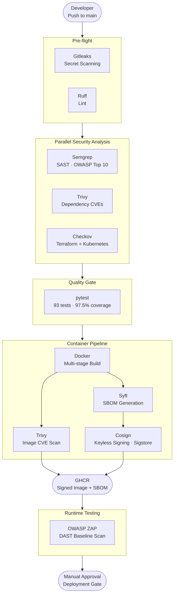
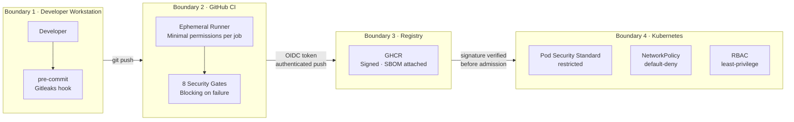
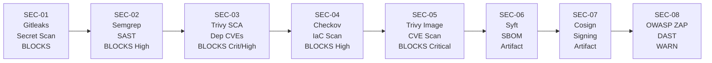
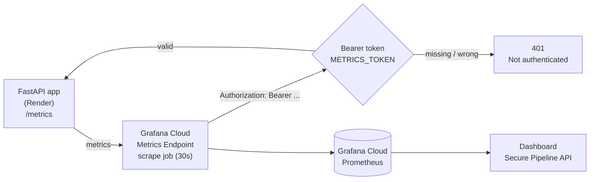

# Secure Pipeline API

A production-grade DevSecOps CI/CD pipeline for a Python FastAPI application.  
Security is built into every stage — not bolted on at the end.

---

## Pipeline Architecture



---

## Trust Boundary Model



---

## Security Gates



---

## AWS Emulator integration tests

The app has optional AWS code paths, all **off by default** (the default is still the in-memory store with no AWS calls):

| Setting | Effect |
|---------|--------|
| `STORAGE_BACKEND=dynamodb` | Users and items are stored in DynamoDB (`DYNAMODB_USERS_TABLE`, `DYNAMODB_ITEMS_TABLE`) |
| `AUDIT_BUCKET=<bucket>` | Every item create/update/delete writes an SSE-encrypted JSON audit record to S3 |
| `EVENTS_QUEUE_URL=<url>` | Every item create/update/delete sends an event to SQS |

Audit records and events contain ids, the event type, a timestamp and the names of changed fields only. Item titles and descriptions are never copied to S3 or SQS. If an audit write or event send fails, the request fails (fail closed).

These paths are tested against [AWS Emulator](https://docs.aws.amazon.com/emulator/latest/userguide/what-is-service.html), AWS's free local emulator, so CI needs **no AWS account, no AWS credentials and no AWS spend**.

### What the CI stage does

The `aws-emulator-tests` job runs in `pr-checks.yml` (on PRs) and in `pipeline.yml` (after pre-flight, in parallel with SAST/SCA/IaC). It runs **alongside** the 8 security gates: no gate was removed, changed or reordered, and no existing job depends on it.

1. Downloads the official `.deb` from `downloads.aws.com` and **refuses to install** unless its GPG signature verifies against the AWS publishing key fingerprint documented by AWS (`scripts/aws-emulator/install-verified.sh`).
2. Fails if `AWS_ACCESS_KEY_ID`, `AWS_SECRET_ACCESS_KEY`, `AWS_SESSION_TOKEN` or `AWS_PROFILE` is set. The job references no secrets.
3. Starts the emulator in the background with telemetry off (`--telemetry off` and `EMULATOR_TELEMETRY=off`) and waits for `https://127.0.0.1:9297/__admin/health`, trusting the generated CA at `~/.aws/emulator/9297/ca.pem` (`scripts/aws-emulator/start.sh`).
4. Points the SDK at it: `AWS_ENDPOINT_URL=https://127.0.0.1:9297`, the generated `config` and `emulator_credentials` files, `AWS_CA_BUNDLE`, `AWS_REGION`/`AWS_DEFAULT_REGION=us-east-1`, `AWS_EC2_METADATA_DISABLED=true`, `AWS_DISABLE_HOST_PREFIX_INJECTION=true`. The emulator's per-run keys are masked in the logs and never printed.
5. Runs `pytest -m aws_emulator`. Each test creates its own DynamoDB tables, S3 bucket and SQS queue and deletes them afterwards.
6. Stops the emulator, which deletes its files and all in-memory resources.

**Safety check:** before any emulator test runs, the suite checks that `AWS_ENDPOINT_URL` and every client's resolved endpoint are `https` on `127.0.0.1`, `localhost` or `::1`, and that no real-credential variables are present. Otherwise **every test fails** (`app/tests/aws/safety.py`).

### Run the integration tests locally (Ubuntu/Debian)

```bash
# 1. Install the emulator (signature-verified, needs sudo for apt-get)
bash scripts/aws-emulator/install-verified.sh

# 2. Start it in the background and wait for the health check
bash scripts/aws-emulator/start.sh

# 3. Point the SDK at it in this shell (also unsets real AWS credential vars)
source scripts/aws-emulator/env.sh

# 4. Run the suite
make test-aws          # = python -m pytest app/tests/aws -m aws_emulator --no-cov

# 5. Stop it
bash scripts/aws-emulator/start.sh stop
```

On other platforms, follow the [AWS Emulator getting-started guide](https://docs.aws.amazon.com/emulator/latest/userguide/getting-started.html) and then do steps 3 and 4. A plain `python -m pytest` (or `make test`) never runs the emulator tests; they are deselected by default.

### Limitations

- **IAM is not enforced.** AWS states that the emulator does not evaluate IAM or resource-based policies. A passing emulator run is **not** evidence that IAM permissions are correct. IAM stays covered by the static gates (Checkov on the Terraform IAM roles) and code review.
- **Unimplemented operations return HTTP 501** (`NotImplemented`). The test fails, and the operation is listed under "AWS Emulator unimplemented operations (HTTP 501)" in the pytest summary. Do not work around it; report it.
- **Fidelity varies by service and operation.** AWS checks emulator behaviour against `us-west-2` (global services against `us-east-1`). Treat these tests as functional tests of our code, not proof of identical AWS behaviour.
- **One account (`000000000000`), resources not separated by Region, everything in memory** and deleted when the emulator stops. Not for load tests or production.
- **Version is not pinned.** AWS publishes the package at an `LTS/latest` URL. The signature check proves it came from AWS. The installed version is printed in the job log.
- **Never load real or cardholder data** into the emulator. Test fixtures are synthetic.

---

## Monitoring and Dashboards

The deployed API exposes Prometheus metrics at `/metrics`. Grafana Cloud scrapes them every 30 seconds, and a dashboard-as-code export lives in the repo.



**Dashboard:** [`monitoring/grafana/secure-pipeline-api.json`](monitoring/grafana/secure-pipeline-api.json)


| Section | Panels |
|---------|--------|
| Overview | Requests/sec, 5xx error rate, p95 latency, memory (RSS) |
| Traffic | Requests/sec by route, requests/sec by status class |
| Latency | p50 / p95 / p99 across all routes, average latency per route |
| Security and runtime | 4xx responses by route, rejected `/metrics` scrapes, CPU and memory |

Traffic panels exclude the scraper's own `/metrics` requests, so they show real API usage only. The memory tile turns orange at 400 MiB and red at 480 MiB (Render free tier limit: 512 MB).

### Securing `/metrics`

`/metrics` exposes route names, traffic volumes and runtime details, so it is not public:

- Requests must send `Authorization: Bearer <METRICS_TOKEN>` (constant-time comparison)
- **Fail-closed:** if `METRICS_TOKEN` is unset, every request gets `401`
- Excluded from the OpenAPI schema
- The response format is negotiated from the scraper's `Accept` header (falls back to Prometheus text format `0.0.4`)
- The dashboard's *Rejected /metrics scrapes* panel records every unauthenticated attempt

### Setup

1. Generate a token and set it as `METRICS_TOKEN` in the hosting environment (Render → Environment). Never commit it.
   ```bash
   python -c "import secrets; print(secrets.token_urlsafe(32))"
   ```
2. In Grafana Cloud: **Connections → Add new connection → Metrics Endpoint**
   - URL: `https://<your-app>/metrics`
   - Authentication: **Bearer**, paste the token (without the `Bearer` prefix)
3. Import the dashboard: **Dashboards → New → Import**, upload `monitoring/grafana/secure-pipeline-api.json`, and select your Grafana Cloud Prometheus data source.

> Grafana Cloud's hosted scraper does not emit the `up` metric. Use `http_requests_total` or `python_info` to check that data is arriving.

---

## What this project demonstrates

| Capability | Implementation |
|------------|---------------|
| Secure API design | FastAPI + JWT auth + IDOR protection + Pydantic validation |
| Secret scanning | Gitleaks (pre-commit + CI) |
| Static analysis | Semgrep (OWASP Top 10 + custom rules) |
| Dependency CVEs | Trivy SCA |
| IaC security | Checkov (Terraform + Kubernetes) |
| Container hardening | Multi-stage Dockerfile, non-root, read-only filesystem |
| Container CVEs | Trivy image scan |
| Software Bill of Materials | Syft (SPDX JSON format) |
| Image signing + provenance | Cosign keyless via GitHub OIDC + Sigstore |
| Dynamic testing | OWASP ZAP baseline scan |
| AWS integration testing | DynamoDB, S3 and SQS code paths tested against the local AWS Emulator (no AWS account) |
| Infrastructure | Terraform modules (networking + EKS) + Kubernetes manifests |
| Kubernetes security | NetworkPolicy default-deny, RBAC, Pod Security Standards |
| Test coverage | pytest, 97%+ coverage, 101 tests |
| Observability | Prometheus `/metrics` (token-protected) + Grafana Cloud dashboard as code |
| Deployment gate | GitHub Environments with manual approval |
| Scheduled rescanning | Weekly Trivy rescan of published images |
| Multi-cloud portability | GHCR now; ECR/ACR/GAR with minimal changes |

---

## Quick start

```bash
# Install dependencies (requires Python 3.12+)
pip install -e ".[dev]"

# Run tests
python -m pytest

# Run linter
python -m ruff check app/

# Start the development server
python -m uvicorn app.main:app --reload --host 127.0.0.1 --port 8000
# API: http://127.0.0.1:8000
# Docs: http://127.0.0.1:8000/docs
```

---

## Project structure

```
├── app/                      FastAPI application
│   ├── api/                  Route handlers and dependency injection
│   ├── aws/                  Optional DynamoDB store, S3 audit, SQS events
│   ├── core/                 Config, JWT security, logging
│   ├── models/               Pydantic request/response models
│   └── tests/                Unit + integration tests; tests/aws = AWS Emulator suite
│
├── monitoring/
│   └── grafana/              Grafana dashboard (JSON, dashboard as code)
│
├── infrastructure/
│   ├── terraform/            Terraform modules (networking, EKS)
│   └── kubernetes/           Kubernetes manifests
│
├── security/
│   ├── .gitleaks.toml        Secret scanning config
│   ├── .semgrep.yml          SAST rules
│   ├── checkov-config.yaml   IaC scanning config
│   ├── zap-config.yaml       DAST config
│   ├── THREAT_MODEL.md       Threat model and trust boundaries
│   └── VULNERABILITY_REMEDIATION.md  Response runbook per gate
│
├── .github/workflows/
│   ├── pipeline.yml          Main CI/CD pipeline (9 jobs)
│   ├── pr-checks.yml         Fast PR feedback
│   ├── scheduled-scan.yml    Weekly rescan
│   └── pages.yml             Documentation site
│
├── scripts/aws-emulator/     Verified install, start/stop, SDK env for AWS Emulator
│
├── docs/
│   ├── ARCHITECTURE.md
│   ├── PIPELINE.md
│   ├── CLOUD_EXTENSION.md
│   ├── RUNBOOK.md
│   └── images/               README screenshots
│
├── Dockerfile                Multi-stage, non-root, read-only FS
├── docker-compose.yml        Local development
└── Makefile                  Local commands mirroring CI
```

---

## Documentation

- [Security Architecture](docs/ARCHITECTURE.md)
- [Pipeline Stage Rationale](docs/PIPELINE.md)
- [Threat Model](security/THREAT_MODEL.md)
- [Vulnerability Remediation](security/VULNERABILITY_REMEDIATION.md)
- [Cloud Extension Guide](docs/CLOUD_EXTENSION.md)
- [Operational Runbook](docs/RUNBOOK.md)
- 📖 [Live Docs Site](https://mbitajeff.github.io/application-delivery-pipeline)

---

## Technology stack

| Category | Technology |
|----------|-----------|
| Application | Python 3.12, FastAPI, Pydantic, bcrypt, python-jose |
| Testing | pytest, pytest-cov, httpx2 |
| Linting | Ruff |
| Container | Docker (multi-stage), python:3.12-slim-bookworm |
| Orchestration | Kubernetes (Kind locally) |
| Infrastructure | OpenTofu (Terraform-compatible) |
| Registry | GHCR |
| Secret scanning | Gitleaks |
| SAST | Semgrep |
| SCA | Trivy |
| IaC scanning | Checkov |
| SBOM | Syft |
| Image signing | Cosign + Sigstore |
| DAST | OWASP ZAP |
| AWS SDK / local AWS | boto3, AWS Emulator |
| CI/CD | GitHub Actions |
| Metrics | prometheus-client, prometheus-fastapi-instrumentator |
| Dashboards | Grafana Cloud (Metrics Endpoint scrape job) |
