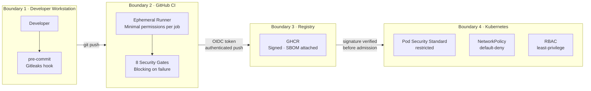
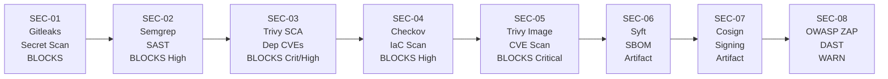
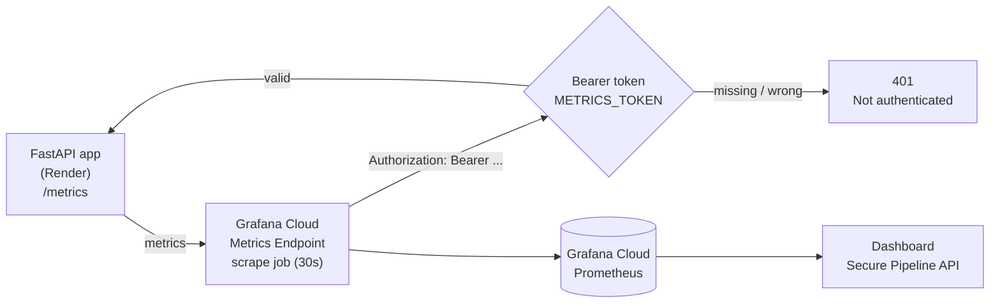
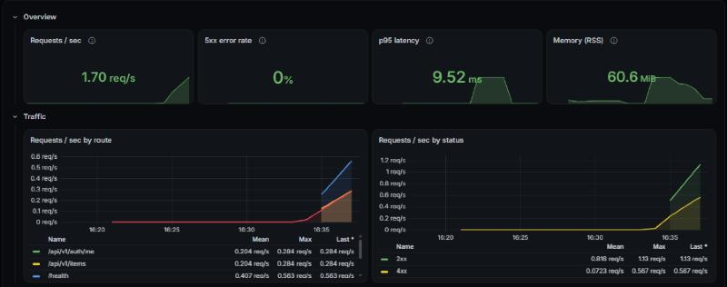
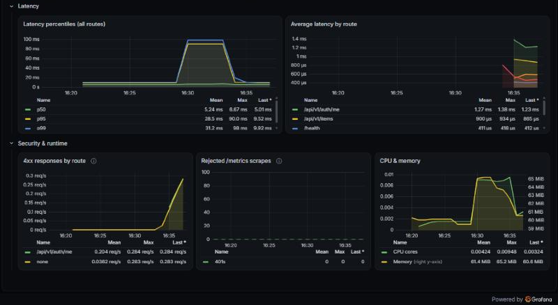

# Secure Pipeline API

A production-grade DevSecOps CI/CD pipeline for a Python FastAPI application.  
Security is built into every stage — not bolted on at the end.

---

## Pipeline Architecture


---

## Trust Boundary Model



---

## Security Gates



---

## Monitoring and Dashboards

The deployed API exposes Prometheus metrics at `/metrics`. Grafana Cloud scrapes them every 30 seconds, and a dashboard-as-code export lives in the repo.



**Dashboard:** [`monitoring/grafana/secure-pipeline-api.json`](monitoring/grafana/secure-pipeline-api.json)





| Section | Panels |
|---------|--------|
| Overview | Requests/sec, 5xx error rate, p95 latency, memory (RSS) |
| Traffic | Requests/sec by route, requests/sec by status class |
| Latency | p50 / p95 / p99 across all routes, average latency per route |
| Security and runtime | 4xx responses by route, rejected `/metrics` scrapes, CPU and memory |

Traffic panels exclude the scraper's own `/metrics` requests, so they show real API usage only. The memory tile turns orange at 400 MiB and red at 480 MiB (Render free tier limit: 512 MB).

### Securing `/metrics`

`/metrics` exposes route names, traffic volumes and runtime details, so it is not public:

- Requests must send `Authorization: Bearer <METRICS_TOKEN>` (constant-time comparison)
- **Fail-closed:** if `METRICS_TOKEN` is unset, every request gets `401`
- Excluded from the OpenAPI schema
- The response format is negotiated from the scraper's `Accept` header (falls back to Prometheus text format `0.0.4`)
- The dashboard's *Rejected /metrics scrapes* panel records every unauthenticated attempt

### Setup

1. Generate a token and set it as `METRICS_TOKEN` in the hosting environment (Render → Environment). Never commit it.
   ```bash
   python -c "import secrets; print(secrets.token_urlsafe(32))"
   ```
2. In Grafana Cloud: **Connections → Add new connection → Metrics Endpoint**
   - URL: `https://<your-app>/metrics`
   - Authentication: **Bearer**, paste the token (without the `Bearer` prefix)
3. Import the dashboard: **Dashboards → New → Import**, upload `monitoring/grafana/secure-pipeline-api.json`, and select your Grafana Cloud Prometheus data source.

> Grafana Cloud's hosted scraper does not emit the `up` metric. Use `http_requests_total` or `python_info` to check that data is arriving.

---

## What this project demonstrates

| Capability | Implementation |
|------------|---------------|
| Secure API design | FastAPI + JWT auth + IDOR protection + Pydantic validation |
| Secret scanning | Gitleaks (pre-commit + CI) |
| Static analysis | Semgrep (OWASP Top 10 + custom rules) |
| Dependency CVEs | Trivy SCA |
| IaC security | Checkov (Terraform + Kubernetes) |
| Container hardening | Multi-stage Dockerfile, non-root, read-only filesystem |
| Container CVEs | Trivy image scan |
| Software Bill of Materials | Syft (SPDX JSON format) |
| Image signing + provenance | Cosign keyless via GitHub OIDC + Sigstore |
| Dynamic testing | OWASP ZAP baseline scan |
| Infrastructure | Terraform modules (networking + EKS) + Kubernetes manifests |
| Kubernetes security | NetworkPolicy default-deny, RBAC, Pod Security Standards |
| Test coverage | pytest, 97%+ coverage, 101 tests |
| Observability | Prometheus `/metrics` (token-protected) + Grafana Cloud dashboard as code |
| Deployment gate | GitHub Environments with manual approval |
| Scheduled rescanning | Weekly Trivy rescan of published images |
| Multi-cloud portability | GHCR now; ECR/ACR/GAR with minimal changes |

---

## Quick start

```bash
# Install dependencies (requires Python 3.12+)
pip install -e ".[dev]"

# Run tests
python -m pytest

# Run linter
python -m ruff check app/

# Start the development server
python -m uvicorn app.main:app --reload --host 127.0.0.1 --port 8000
# API: http://127.0.0.1:8000
# Docs: http://127.0.0.1:8000/docs
```

---

## Project structure

```
├── app/                      FastAPI application
│   ├── api/                  Route handlers and dependency injection
│   ├── core/                 Config, JWT security, logging
│   ├── models/               Pydantic request/response models
│   └── tests/                Unit + integration tests (101 tests)
│
├── monitoring/
│   └── grafana/              Grafana dashboard (JSON, dashboard as code)
│
├── infrastructure/
│   ├── terraform/            Terraform modules (networking, EKS)
│   └── kubernetes/           Kubernetes manifests
│
├── security/
│   ├── .gitleaks.toml        Secret scanning config
│   ├── .semgrep.yml          SAST rules
│   ├── checkov-config.yaml   IaC scanning config
│   ├── zap-config.yaml       DAST config
│   ├── THREAT_MODEL.md       Threat model and trust boundaries
│   └── VULNERABILITY_REMEDIATION.md  Response runbook per gate
│
├── .github/workflows/
│   ├── pipeline.yml          Main CI/CD pipeline (9 jobs)
│   ├── pr-checks.yml         Fast PR feedback
│   ├── scheduled-scan.yml    Weekly rescan
│   └── pages.yml             Documentation site
│
├── docs/
│   ├── ARCHITECTURE.md
│   ├── PIPELINE.md
│   ├── CLOUD_EXTENSION.md
│   ├── RUNBOOK.md
│   └── images/               README screenshots
│
├── Dockerfile                Multi-stage, non-root, read-only FS
├── docker-compose.yml        Local development
└── Makefile                  Local commands mirroring CI
```

---

## Documentation

- [Security Architecture](docs/ARCHITECTURE.md)
- [Pipeline Stage Rationale](docs/PIPELINE.md)
- [Threat Model](security/THREAT_MODEL.md)
- [Vulnerability Remediation](security/VULNERABILITY_REMEDIATION.md)
- [Cloud Extension Guide](docs/CLOUD_EXTENSION.md)
- [Operational Runbook](docs/RUNBOOK.md)
- 📖 [Live Docs Site](https://mbitajeff.github.io/application-delivery-pipeline)

---

## Technology stack

| Category | Technology |
|----------|-----------|
| Application | Python 3.12, FastAPI, Pydantic, bcrypt, python-jose |
| Testing | pytest, pytest-cov, httpx2 |
| Linting | Ruff |
| Container | Docker (multi-stage), python:3.12-slim-bookworm |
| Orchestration | Kubernetes (Kind locally) |
| Infrastructure | OpenTofu (Terraform-compatible) |
| Registry | GHCR |
| Secret scanning | Gitleaks |
| SAST | Semgrep |
| SCA | Trivy |
| IaC scanning | Checkov |
| SBOM | Syft |
| Image signing | Cosign + Sigstore |
| DAST | OWASP ZAP |
| CI/CD | GitHub Actions |
| Metrics | prometheus-client, prometheus-fastapi-instrumentator |
| Dashboards | Grafana Cloud (Metrics Endpoint scrape job) |
