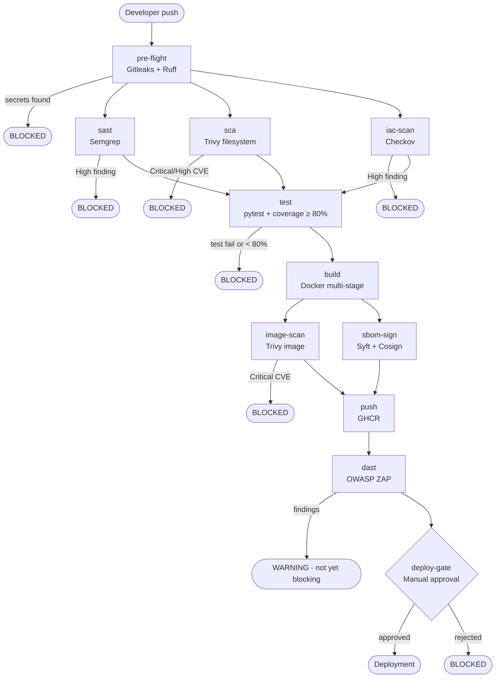

# Security Architecture

## Overview

The Secure Pipeline API project implements a DevSecOps pipeline where security controls are embedded at every stage — not added as a final gate before release.

---

## System Architecture

```
┌─────────────────────────────────────────────────────────────────────────┐
│  Developer workstation                                                   │
│                                                                          │
│  ┌─────────────┐    pre-commit    ┌─────────────┐                       │
│  │  IDE/editor │ ──────────────►  │  git commit │                       │
│  └─────────────┘                 │  Gitleaks   │                       │
│                                   └──────┬──────┘                       │
└──────────────────────────────────────────┼──────────────────────────────┘
                                           │ git push
┌──────────────────────────────────────────▼──────────────────────────────┐
│  GitHub                                                                  │
│                                                                          │
│  ┌─────────────────────────────────────────────────────────────────┐    │
│  │  Branch protection: PR review required + all CI checks pass     │    │
│  └─────────────────────────────────────────────────────────────────┘    │
│                                                                          │
│  GitHub Actions (ephemeral runners)                                      │
│  ┌────────────┐  ┌────────┐  ┌──────────┐  ┌───────┐  ┌──────────┐    │
│  │ Gitleaks   │  │Semgrep │  │Trivy SCA │  │Checkov│  │  pytest  │    │
│  │ secret scan│  │  SAST  │  │   deps   │  │  IaC  │  │ coverage │    │
│  └────────────┘  └────────┘  └──────────┘  └───────┘  └──────────┘    │
│                                                                          │
│  ┌────────────┐  ┌──────────────────────┐  ┌────────────────────────┐  │
│  │Docker build│  │ Trivy image scan      │  │ Syft SBOM + Cosign sign│  │
│  │multi-stage │  │ CRITICAL CVEs → FAIL  │  │ Keyless via OIDC       │  │
│  └────────────┘  └──────────────────────┘  └────────────────────────┘  │
│                                                                          │
│  ┌────────────────────┐  ┌──────────────────────────────────────────┐  │
│  │ OWASP ZAP (DAST)   │  │  Deploy gate (manual approval required)  │  │
│  │ baseline scan      │  │  GitHub Environment: production          │  │
│  └────────────────────┘  └──────────────────────────────────────────┘  │
└──────────────────────────────┬──────────────────────────────────────────┘
                               │ OCI push (GITHUB_TOKEN)
┌──────────────────────────────▼──────────────────────────────────────────┐
│  GHCR (GitHub Container Registry)                                        │
│                                                                          │
│  Image: ghcr.io/owner/secure-pipeline-api:sha-abc1234                   │
│  ├── Cosign signature (keyless, Sigstore Rekor transparency log)        │
│  ├── SBOM attestation (SPDX JSON format)                                │
│  └── Scan result attestation                                            │
└──────────────────────────────┬──────────────────────────────────────────┘
                               │ kubectl apply (future)
┌──────────────────────────────▼──────────────────────────────────────────┐
│  Kubernetes Cluster (Kind locally / EKS in production)                  │
│                                                                          │
│  Namespace: secure-pipeline                                              │
│  ┌─────────────────────────────────────────────────────────────────┐    │
│  │ Pod Security Standard: restricted                                │    │
│  │ - Non-root user (UID 1000)                                      │    │
│  │ - Read-only root filesystem                                      │    │
│  │ - All capabilities dropped                                       │    │
│  │ - No privilege escalation                                        │    │
│  └─────────────────────────────────────────────────────────────────┘    │
│                                                                          │
│  ┌────────────────────┐  ┌──────────────┐  ┌───────────────────────┐   │
│  │ NetworkPolicy:     │  │  RBAC:       │  │  Deployment:          │   │
│  │ default deny-all   │  │  Empty Role  │  │  2 replicas           │   │
│  │ + explicit allows  │  │  No K8s API  │  │  Rolling update       │   │
│  └────────────────────┘  └──────────────┘  └───────────────────────┘   │
└─────────────────────────────────────────────────────────────────────────┘
```

---

## Pipeline Security Architecture



---

## Application Security Architecture

### Authentication Flow

```
Client                    API                       Token Store
  │                        │                            │
  │  POST /auth/login       │                            │
  │  {username, password}  │                            │
  ├───────────────────────►│                            │
  │                        │  get_user_by_username()    │
  │                        ├───────────────────────────►│
  │                        │◄───────────────────────────┤
  │                        │                            │
  │                        │  bcrypt.checkpw()          │
  │                        │  (constant-time compare)   │
  │                        │                            │
  │◄───────────────────────┤                            │
  │  200 {access_token}    │                            │
  │                        │                            │
  │  GET /api/v1/items      │                            │
  │  Authorization: Bearer  │                            │
  ├───────────────────────►│                            │
  │                        │  decode_access_token()     │
  │                        │  Verify HS256 signature    │
  │                        │  Check exp claim           │
  │                        │  get_user_by_username(sub) │
  │                        ├───────────────────────────►│
  │                        │◄───────────────────────────┤
  │◄───────────────────────┤                            │
  │  200 {items}           │                            │
```

### IDOR Prevention

```
Client (user B)           API                       Data store
  │                        │                            │
  │  PATCH /items/42        │                            │
  │  (item owned by user A)│                            │
  ├───────────────────────►│                            │
  │                        │  get_item(42)              │
  │                        ├───────────────────────────►│
  │                        │◄─── {owner_id: user_A_id} ─┤
  │                        │                            │
  │                        │  current_user.id ≠ owner_id│
  │                        │  → HTTP 403               │
  │◄───────────────────────┤                            │
  │  403 Forbidden         │                            │
```

---

## Security Controls Matrix

| Layer | Control | Implementation | Verified by |
|-------|---------|---------------|-------------|
| Source | Secret scanning | Gitleaks | Pipeline Gate 1 |
| Source | SAST | Semgrep | Pipeline Gate 2 |
| Source | Dependency CVEs | Trivy SCA | Pipeline Gate 3 |
| Source | Input validation | Pydantic models | Test suite |
| Source | Type safety | Python type hints + Ruff | Lint |
| Infrastructure | IaC misconfig | Checkov | Pipeline Gate 4 |
| Container | Base image CVEs | Trivy image scan | Pipeline Gate 5 |
| Container | Non-root runtime | Dockerfile USER + K8s securityContext | Dockerfile + PSS |
| Container | No build tools in runtime | Multi-stage Dockerfile | Dockerfile |
| Container | Provenance | Cosign + Sigstore | SEC-07 |
| Container | Inventory | Syft SBOM | SEC-06 |
| Application | Authentication | JWT HS256, bcrypt passwords | Test suite |
| Application | Authorisation | Owner check on mutation | IDOR tests |
| Application | User enumeration | Generic 401 | Integration tests |
| Application | Timing attacks | Constant-time password compare | Code review |
| Kubernetes | Network isolation | NetworkPolicy default-deny | Manifest |
| Kubernetes | Least privilege | Empty RBAC Role, no SA token | Manifest |
| Kubernetes | Pod hardening | Pod Security Standard: restricted | Namespace label |
| Kubernetes | Traffic security | TLS at Ingress, HSTS header | Ingress annotations |
| Runtime | Threat detection | Falco (future) | — |
| Runtime | Dynamic testing | OWASP ZAP | Pipeline Gate 6 |
